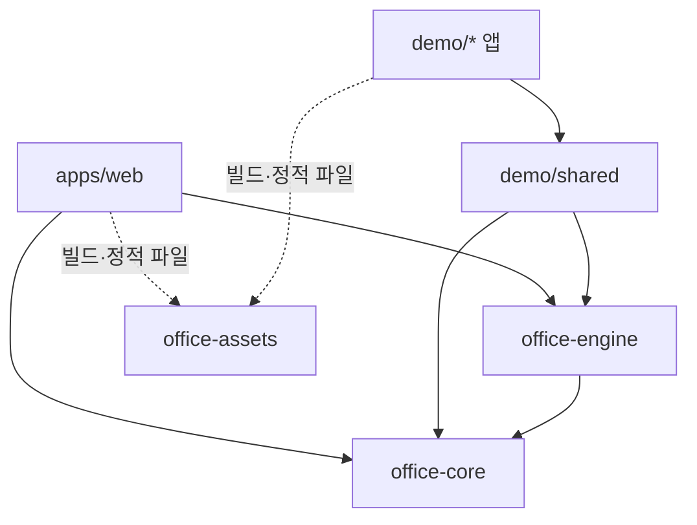

# pnpm 모노레포 구성

2026-10-15, epic #46에서 서비스·데모·공유 기능을 분리했다. pnpm 9.15.5를 사용한다.

| 위치 | 패키지 | 책임 |
|---|---|---|
| `apps/web` | `@pixel-office/web` | 에이전트 이벤트 수신, 상태 목록, 오피스 화면 |
| `packages/office-core` | `@pixel-office/core` | 순수 타입·점유 검사·A*·가구 카탈로그·레이아웃 생성 |
| `packages/office-engine` | `@pixel-office/engine` | Phaser 캐릭터·말풍선·이동 controller·좌석·React 캔버스·이벤트 버스 |
| `packages/office-assets` | `@pixel-office/assets` | 에셋 단일 원본, 생성 스크립트, Vite 에셋 설정 |
| `demo/shared` | `@pixel-office/demo-shared` | 데모 전용 시나리오·씬·탐색·초기화. 제품 앱에서 사용 금지 |
| `demo/<이름>` | `@pixel-office/demo-<이름>` | 데모별 독립 실행·빌드 진입점 |



## 실행·검증

- 설치: `pnpm install --frozen-lockfile`
- 서비스: `pnpm dev` → `http://localhost:5199/`
- 모든 데모: `pnpm dev:demos`
- 개별 데모: `pnpm --filter @pixel-office/demo-agent-collision dev`
- 전체 검사: `pnpm typecheck`, `pnpm lint`, `pnpm test`, `pnpm build`
- 에셋 생성: `pnpm assets:build` (`uv` 필요)
- 서비스 preview: `pnpm preview`
- 개별 데모 preview: `pnpm --filter @pixel-office/demo-agent-collision preview`

| 데모 디렉터리 | 개발 포트 | 배포 경로 |
|---|---|---|
| `demo/pixel-agents-office` | 5200 | `/demo/pixel-agents-office/` |
| `demo/interior-assets` | 5201 | `/demo/interior-assets/` |
| `demo/obstacle-walking` | 5202 | `/demo/obstacle-walking/` |
| `demo/agent-collision` | 5203 | `/demo/agent-collision/` |
| `demo/agent-crowd-collision` | 5204 | `/demo/agent-crowd-collision/` |
| `demo/depth-sorting` | 5205 | `/demo/depth-sorting/` |
| `demo/speech-bubble` | 5206 | `/demo/speech-bubble/` |
| `demo/speech-bubble-font` | 5207 | `/demo/speech-bubble-font/` |
| `demo/random-office-chatter` | 5208 | `/demo/random-office-chatter/` |

각 앱의 `dist`가 독립 배포 산출물이다. 같은 호스트에 배포할 때 `apps/web/dist`는 `/`, 각 `demo/<이름>/dist`는 표의 경로에 배치한다. 데모 간 탐색은 개발 환경에서는 포트별 URL, 배포 환경에서는 동일 호스트의 `/demo/<이름>/`을 사용한다. 한 데모만 실행한 경우 다른 데모 링크의 서버는 별도로 실행해야 한다. 과거 서비스의 `/#/demo/*` 라우트는 제거했다.

## 패키지 사용 계약

- 의존성은 `workspace:*`, import는 `package.json`의 명시적 `exports`를 사용한다. 앱 소스 상대 경로나 TS alias로 패키지 경계를 우회하지 않는다.
- `@pixel-office/core`는 브라우저·React·Phaser 없이 실행된다. `/pathfinding`, `/agentOccupancy`, `/pixelAgents`에서 이동·점유·자동 레이아웃 기능을 제공한다.
- `@pixel-office/engine/agent-office`의 `AgentOffice`는 업무 좌석 9개·회의실·라운지가 있는 서비스 오피스를 마운트한다. `/furnished-scene`은 동일 레이아웃의 데모에서도 재사용한다.
- `@pixel-office/engine/react`의 `PhaserGame`은 최소 테스트 맵과 줌 도구를 마운트한다. `debug`와 `autoAssignSeats`로 계측·자동 좌석 배정을 명시한다. 데모 ID 문자열로 동작을 분기하지 않는다.
- `/character`, `/speech`, `/movement`, `/pathfinding`, `/events`, `/pixel-assets` 등으로 개별 기능을 소비한다. 기본 `gameBus`를 사용하는 캔버스는 앱 문서당 하나를 전제로 한다.
- 공통 CSS는 `/fonts.css`, `/styles.css`를 사용한다. 데모 스타일과 시나리오는 `demo/shared`에 둔다. 서비스 오피스의 연결 전 미리보기는 공유 씬에서 제공한다.
- 공유 패키지는 TypeScript 소스를 export하며 Vite가 소비 앱에서 번들링한다. 패키지 `build`는 타입 검사다. 별도 Node 배포용 JS 라이브러리 산출물은 만들지 않는다.
- 앱의 Vite 설정은 `@pixel-office/assets/vite`의 `officeViteConfig`를 사용한다. `publicDir`을 공용 원본에 연결하며 빌드 시 각 앱 `dist`에 복사한다. 에셋 URL은 각 앱의 `BASE_URL`을 따른다. 원본 PNG를 앱마다 복제해 관리하지 않는다.

## 서비스 이벤트 계약

서비스는 연결 전 샘플 캐릭터 10명(착석 6명·이동 4명)을 표시하고 상태 패널에 미리보기임을 명시한다. 첫 실제 upsert를 받으면 샘플·이동 타이머를 정리하고 실제 캐릭터로 전환한다. 이후 실제 에이전트가 모두 제거되어도 샘플을 다시 만들지 않는다. 샘플은 실제 에이전트 목록에 등록하지 않으며 무작위 대화는 생성하지 않는다.

같은 origin의 현재 창 또는 부모 창에서 아래 메시지를 전달한다.

```ts
window.postMessage({
  channel: 'pixel-office',
  event: {
    type: 'agent:upsert',
    agent: { id: 'worker-1', name: 'Worker', status: 'idle', updatedAt: Date.now() },
  },
}, window.location.origin);
```

이벤트 타입은 `@pixel-office/core`의 `AgentEvent`를 따른다. `agent:status`, `agent:move`, `agent:seat`, `agent:say`, `agent:remove`를 지원한다. 최초 upsert 이후 상태·이동·발화 이벤트를 보낸다. 표시 목록은 마지막 수신 상태를 보여주며 자동 시뮬레이션 상태를 생성하지 않는다.

- `game:ready` 전 수신 이벤트는 최대 1024개까지 순서대로 대기한다. 초과·잘못된 형식·외부 origin 메시지는 무시한다.
- 준비 후 부모 창에 `{ channel: 'pixel-office', type: 'ready' }`를 보낸다. 재접속 시 호스트는 현재 스냅샷을 upsert로 다시 전송한다.
- HMR 해제 시 메시지·버스 구독과 캔버스를 정리한다.
- 이는 브라우저 호스트 계약이다. Claude Code/Codex 프로세스나 VS Code extension의 실제 상태 수집 구현은 기존 #33의 후속 범위다.

## 검증 위치

- `packages/office-core/tests`: 레이아웃 결정성·좌석·리사이즈 캐시
- `packages/office-engine/tests`: 캐릭터 충돌·예약·이동 재계산 controller 회귀
- `demo/shared/tests`: 랜덤·픽셀 오피스 데모의 점유 회귀
- `apps/web/tests`: 수신 이벤트 검증·ready 대기·구독 해제

기존 문서의 `src`, `public` 경로는 당시 앱 기준이다. 현재 위치는 위 패키지 책임 표를 따른다.
